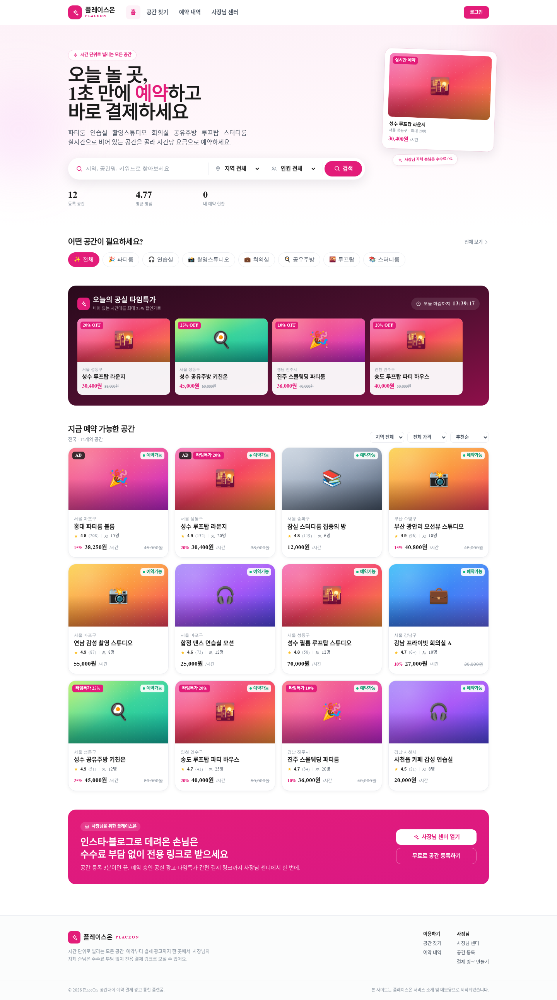
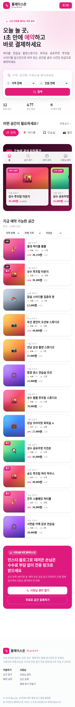
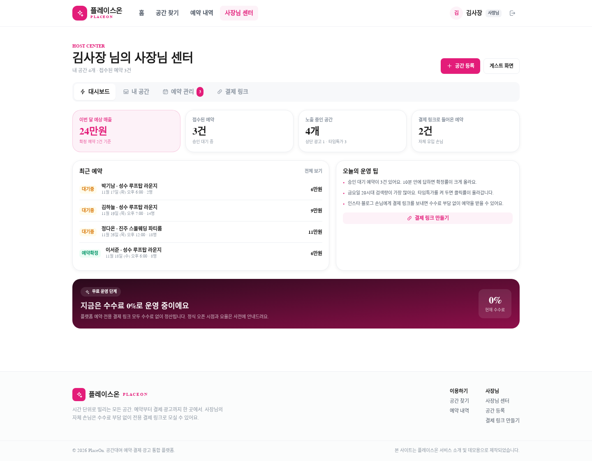
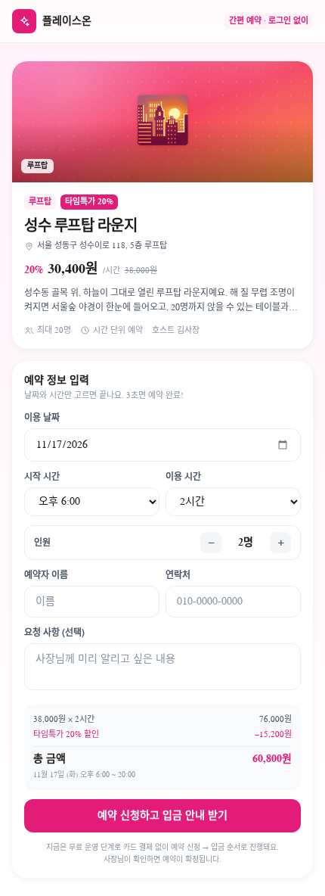

# 플레이스온 PlaceOn 🩷

> 시간 단위로 빌리는 모든 공간 — 예약부터 결제·광고까지 한 곳에서.
> 공간대여 사장님을 위한 **결제 + 광고 통합 플랫폼**의 실제 동작하는 PC·모바일 반응형 웹앱입니다.

- **브랜드**: 플레이스온 (PlaceOn)
- **메인 컬러**: 팬톤 핫핑크 `#E31C79` / 호버 `#DA1884` / 배경 포인트 `#FDF2F8`
- **UI 레퍼런스**: 야놀자 스타일의 카드형 검색·카테고리·타임특가·즉시예약 UI
- **기술 스택**: Next.js 15 (App Router, TypeScript) · Tailwind CSS · Supabase(선택)



| 모바일 홈 | 사장님 센터 |
| --- | --- |
|  |  |

| 전용 결제 링크 페이지 (모바일) |
| --- |
|  |

---

## 1. 바로 체험하기 (1초 테스트 계정)

로그인 화면에서 아래 버튼을 누르면 바로 들어갈 수 있어요.

| 구분 | 이메일 | 비밀번호 |
| --- | --- | --- |
| 게스트 | `guest@placeon.kr` | `placeon1234` |
| 사장님 | `host@placeon.kr` | `placeon1234` |

> 체험 계정 버튼은 처음 누를 때 자동으로 로그인(없으면 가입)됩니다.
> Supabase를 연결하지 않으면 **데모 모드**로 동작하며, 계정·공간·예약이 이 브라우저의 저장소(localStorage)에 실제로 저장됩니다.

---

## 2. 구현된 페이지 & 기능

| 경로 | 화면 | 핵심 기능 |
| --- | --- | --- |
| `/` | 홈 (게스트) | 통합 검색(지역·공간명·키워드·인원), 7개 카테고리 필터, 오늘의 공실 타임특가 + 실시간 카운트다운, 지역/가격대/정렬 필터, 실시간 예약 가능 카드 리스트 |
| `/search` | 공간 찾기 | 키워드·카테고리·지역·가격대·인원·정렬 필터, 결과 개수·초기화, 모바일 앱형 필터 바 |
| `/spaces/[id]` | 공간 상세 | 공간 소개·시설·이용 안내·호스트 정보, 날짜/시작시간/이용시간/인원 선택 → **실시간 총액 계산**(타임특가 자동 적용) → 예약 신청, 무료 운영 단계 계좌이체 안내 + 호스트 전용 결제 링크 안내 |
| `/bookings` | 예약 내역 | 전체/대기중/확정/취소 탭, 예약 취소, 결제 링크 예약 표시, 요청사항·연락처·금액 확인 |
| `/auth` | 로그인 / 회원가입 | 이메일·비밀번호, 게스트/사장님 역할 선택, **1초 테스트 체험 계정** 버튼 |
| `/host` | 사장님 센터 | 대시보드(이번 달 예상 매출·접수 예약·노출 공간·링크 유입), 내 공간 **등록/수정/삭제**, 예약 **승인/거절/취소**, 공실 광고 ON/OFF, 타임특가 ON/OFF, **전용 결제 링크 1초 생성·복사·DM 문구 복사** |
| `/pay/[slug]` | 전용 간편 결제·예약 | 로그인 없이 이름·연락처만 입력 → 예약 신청 접수, 금액 자동 계산, 입금 안내. 인스타 DM·블로그·카톡에 붙여 쓰는 손님용 링크 |

### 동작하는 상태 관리

- 회원가입 → 로그인 → 세션 유지
- 공간 등록/수정/삭제 → 홈·검색·상세에 즉시 반영
- 예약 신청 → 사장님 센터 접수 → 승인/거절 → 게스트 예약 내역 상태 변경
- 타임특가·상단 노출 광고 토글 → 홈 특가 섹션·카드 AD 배지에 즉시 반영
- 결제 링크 생성 → `/pay/[slug]`에서 실제 예약 접수 (비로그인 손님 포함)

---

## 3. 로컬 실행

```bash
cd placeon-web
npm install
npm run dev        # http://localhost:3000
```

프로덕션 빌드 검증:

```bash
npm run build
npm start
```

> Node.js 20 이상을 권장합니다.

---

## 4. 무료 배포: Vercel + Supabase 3단계

### ① Supabase 준비 (5분)

1. [supabase.com](https://supabase.com) → **New project** (무료 플랜)
2. 좌측 **SQL Editor** → `supabase/schema.sql` 내용을 전체 붙여넣고 **Run**
   - `profiles`, `spaces`, `bookings` 테이블 / RLS 정책 / 회원가입 자동 프로필 트리거 / 샘플 공간 4개 생성
3. **Project Settings → API** 에서 두 값을 복사
   - `Project URL` → `NEXT_PUBLIC_SUPABASE_URL`
   - `anon public key` → `NEXT_PUBLIC_SUPABASE_ANON_KEY`

> `anon key`는 공개되어도 되는 키입니다(RLS로 보호). `service_role` 키는 절대 브라우저에 넣지 마세요.

### ② Vercel 배포 (2분)

1. [vercel.com](https://vercel.com) → **Add New → Project**
2. 이 GitHub 저장소(`placeon-web`)를 **Import** — Framework는 Next.js로 자동 인식됩니다.
3. **Environment Variables** 에 위 두 값을 추가 → **Deploy**

### ③ 배포 후

- 환경변수를 넣으면 자동으로 **Supabase 모드**로 전환됩니다. (넣지 않으면 데모 모드)
- Supabase **Authentication → Providers → Email** 에서 이메일 인증을 끄면 가입 즉시 로그인되어 테스트가 편해요.
- 배포 도메인에서 회원가입 → 공간 등록 → 예약 → 승인 → 결제 링크 순서로 바로 확인할 수 있습니다.

### 환경변수

```bash
# placeon-web/.env.local
NEXT_PUBLIC_SUPABASE_URL=https://xxxxxxxx.supabase.co
NEXT_PUBLIC_SUPABASE_ANON_KEY=eyJhbGciOi...
```

`.env.local`은 `.gitignore`에 포함되어 있어 커밋되지 않습니다. 실제 키를 코드나 저장소에 올리지 마세요.

---

## 5. 데모 모드 vs Supabase 모드

| | 데모 모드 (환경변수 없음) | Supabase 모드 |
| --- | --- | --- |
| 데이터 저장 | 브라우저 localStorage | Supabase Postgres |
| 계정 | 브라우저 안에서만 | 실제 이메일 계정 |
| 결제 링크 공유 | 만든 브라우저에서만 열림 | 손님 기기에서도 열림 |
| 배포 후 테스트 | 즉시 가능 (0원) | 프로젝트 생성 후 가능 (무료 플랜) |

코드는 두 모드를 같은 인터페이스(`src/lib/db.ts`)로 처리합니다. 환경변수가 있으면 자동으로 Supabase Auth/DB를 사용합니다.

---

## 6. 폴더 구조

```
placeon-web/
├─ src/
│  ├─ app/
│  │  ├─ page.tsx              # 홈
│  │  ├─ search/page.tsx       # 공간 찾기
│  │  ├─ spaces/[id]/page.tsx  # 공간 상세·예약
│  │  ├─ bookings/page.tsx     # 예약 내역
│  │  ├─ auth/page.tsx         # 로그인·회원가입
│  │  ├─ host/page.tsx         # 사장님 센터
│  │  └─ pay/[slug]/page.tsx   # 전용 간편 결제 링크
│  ├─ components/              # AppProvider, 헤더/하단탭, 카드, 필터 등
│  └─ lib/                     # 타입, Supabase/로컬 저장소, 시드, 포맷
├─ supabase/schema.sql         # 테이블·RLS·트리거·샘플 데이터
├─ docs/preview/               # 화면 캡처
└─ .env.example
```

---

## 7. 검증 결과

- `npm install` 완료 (Next.js 15.5.29, React 19, Tailwind 3.4)
- `npm run build` **성공** — TypeScript 타입 검사 및 프로덕션 빌드 통과
- 8개 라우트 생성 확인 (`/`, `/search`, `/spaces/[id]`, `/bookings`, `/auth`, `/host`, `/pay/[slug]`, `/_not-found`)
- 실제 브라우저(Chromium 390px 모바일 / 1440px 데스크톱) 자동 테스트로 아래 흐름 검증
  - 게스트 체험 로그인 → 예약 신청 → 예약 내역 표시
  - 사장님 체험 로그인 → 공간 등록 → 예약 승인 → 상태 변경
  - 전용 결제 링크 생성 → `/pay/[slug]` 비로그인 예약 접수
  - 콘솔 에러 0건

---

## 8. 다음 단계 (실서비스 전 체크)

- **실제 결제**: 토스페이먼츠·포트원(PG) 연동 + 정산 계좌/세금계산서
- **알림**: 예약 접수·확정 시 알림톡(카카오 비즈) 또는 문자
- **이미지 업로드**: Supabase Storage 버킷 + 공간 사진 여러 장
- **보안 강화**: 예약 금액·상태 변경을 Supabase RPC(Edge Function)에서 서버 검증
- **정산 자동화**: 월별 정산 리포트, 수수료 정책(현재 무료 0% 단계)
- **본인 인증**: 사장님 계좌·사업자 정보 확인

---

© 2026 PlaceOn. 공간대여 예약·결제·광고 통합 플랫폼.
